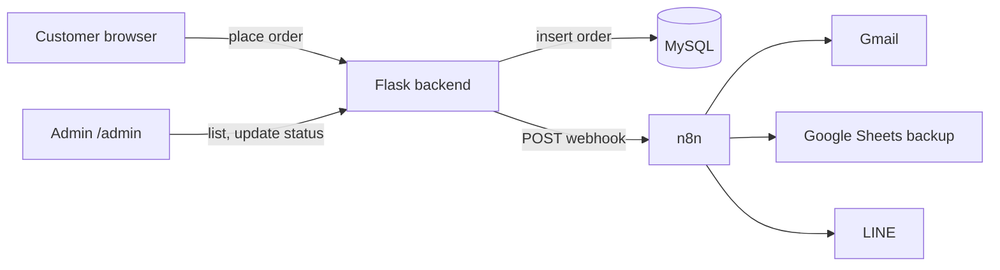

# Maple Leaf Eatery — Online Ordering System

**English**｜[繁體中文](README.md)

Customers order from a web page; each order is saved to MySQL and forwarded to n8n, which sends a Gmail notification, appends a Google Sheets row and pushes a LINE message to the shop. The shop also has an admin page to review orders and update their status.

**Live demo (front-end only, no database or n8n):** https://b3879121-rgb.github.io/order-system/

## Screenshots

### Customer order page

Photo menu, quantity buttons and a live total; choose pickup/delivery and payment, then confirm.


### Admin

**Active**: daily stats (revenue, completed orders, cash/card, cancelled, items sold) and open orders — start, complete or cancel.


**Completed**: counted in revenue; can be moved back to in progress.


**Cancelled**: excluded from revenue; can be restored as a new order.


### n8n workflow


### Notifications

| LINE | Gmail |
|---|---|
|  |  |

## Architecture



## Features

- Photo menu grouped by category, quantity steppers, live total, pickup or delivery, order notes
- Cash or card payment choice (paid at pickup/delivery; no card data is collected) and a confirmation dialog before an order is submitted
- Remembers returning customers' name and phone (localStorage); responsive layout with a sticky mobile total bar
- Admin page with HTTP Basic auth: shows active orders only, a completed order leaves the list and counts toward the day's revenue, undo for mistakes, and a badge on orders whose n8n notification failed
- Daily summary (revenue, done count, cash vs card, cancelled, per-item sales) and one-click Excel export with formula-injection protection
- n8n workflow fans out to Gmail, Google Sheets and the LINE Messaging API

## Design decisions

| Concern | Approach |
|---|---|
| Client-side price tampering | The server receives only item IDs and quantities and recomputes every price from its own menu |
| A failing third party must not block orders | Save to MySQL first, then notify n8n; a failure is logged and flagged, not returned to the customer |
| Order and line items must stay consistent | Both tables are written in one transaction and rolled back on error |
| Customer text shown in the admin page | Escaped before rendering to prevent XSS |
| Spam on the public order endpoint | Per-IP limit of 6 orders per 10 minutes (HTTP 429) |
| SQL injection | Parameterised queries only |
| Secrets | Read from environment variables; `.env` is git-ignored |

## Stack

Python, Flask, PyMySQL, MySQL, n8n, vanilla HTML / CSS / JavaScript, gunicorn

## Run locally

Requires Python 3.10+ and MySQL.

```bash
pip install -r requirements.txt
cp .env.example .env     # Windows: copy .env.example .env
# edit .env: MySQL password, admin password, n8n webhook URL
python app.py
```

Order page: http://localhost:5000 · Admin: http://localhost:5000/admin (user `admin`, password from `ADMIN_PASSWORD`)

Tables are created automatically on startup. In n8n, use a `POST` Webhook node and connect Gmail, Google Sheets and an HTTP Request node (LINE) in parallel; the order JSON is under `$json.body`.

## Known limitations

- The menu lives in `app.py` and has no admin editor yet
- The rate limiter is in-process memory; use Redis if running several workers
- Single-password Basic auth, no user accounts or roles
- Payment method is recorded only; no online payment gateway

## Image credits

Photos from [Unsplash](https://unsplash.com/?utm_source=maple_order&utm_medium=referral): K X I T H V I S U A L S, Xavier Chng, Trista Le, Jonathan Lim, Daily Food Shot, Chinh Le Duc, Uehara Photography, Snappr, Moonyang Lin.
