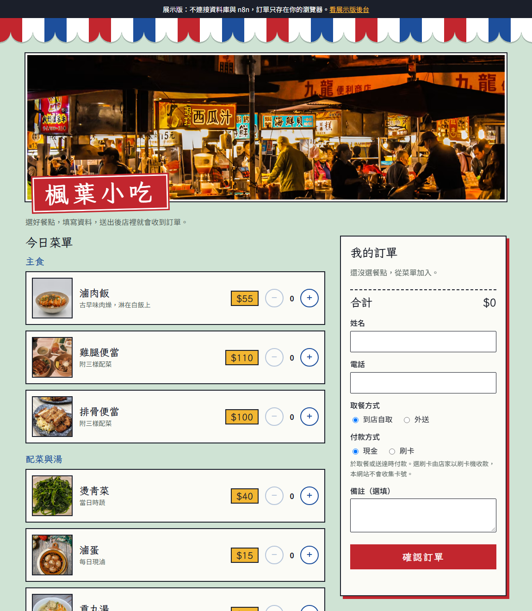
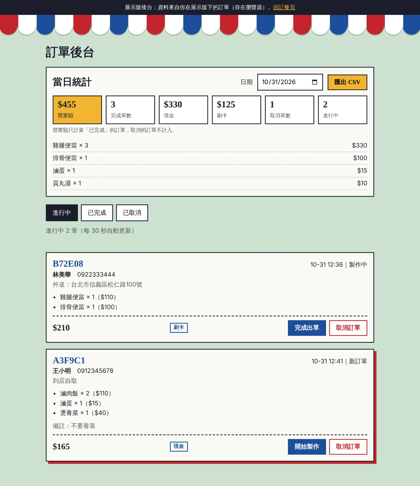
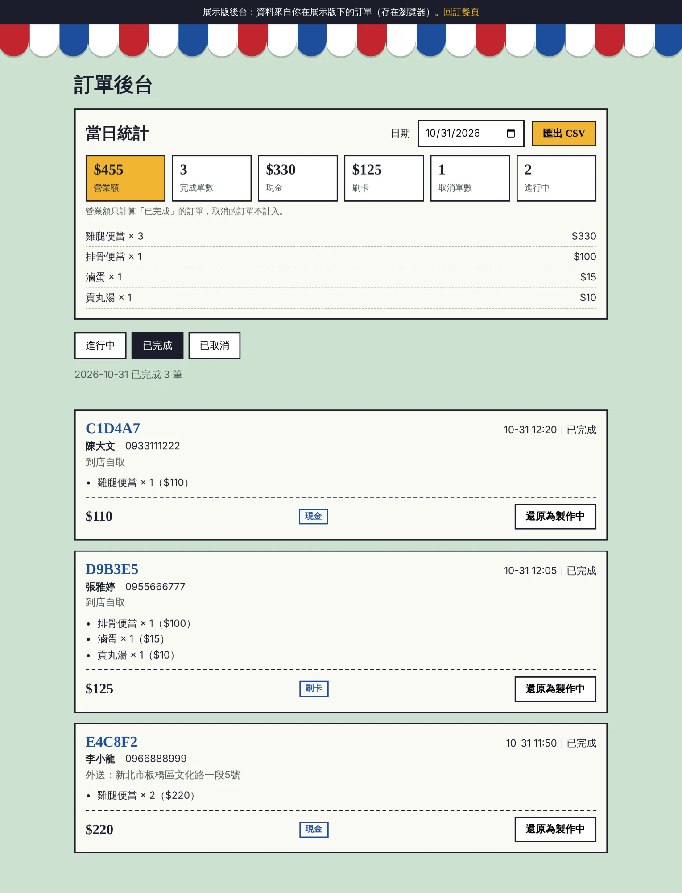
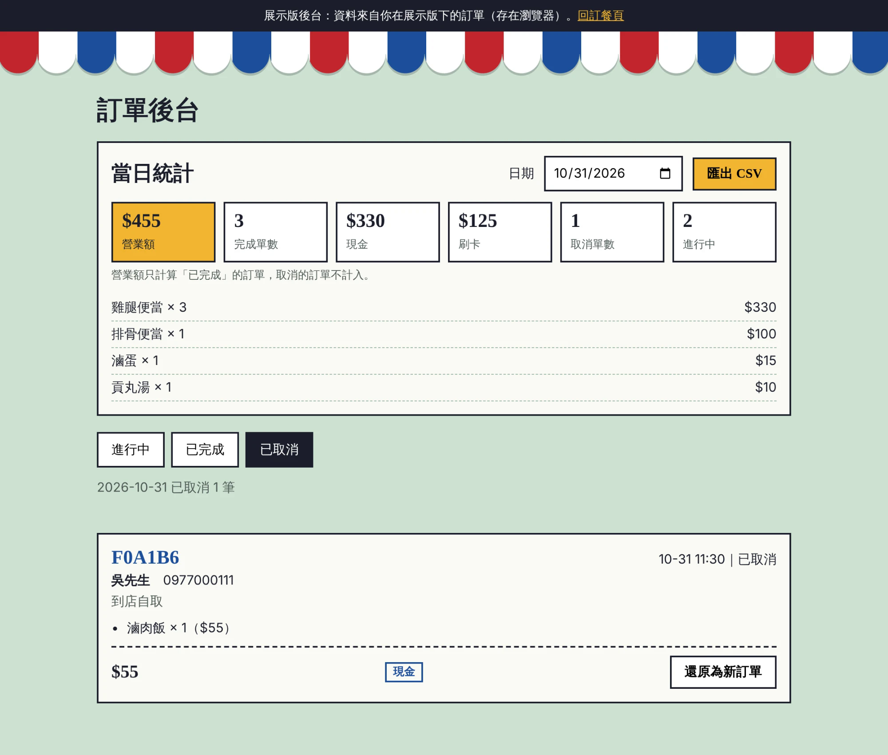
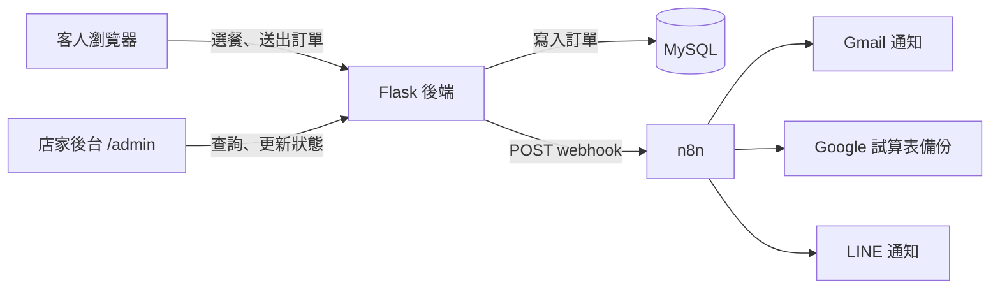

# 楓葉小吃線上訂餐系統

[English](README.en.md)｜**繁體中文**

客人在網頁選餐下單，訂單存進 MySQL，並透過 n8n 自動寄 Gmail、寫入 Google 試算表、傳 LINE 通知店家。店家另有後台可以查看訂單、更新製作狀態。

**展示版（純前端模擬，不連資料庫與 n8n）：** https://b3879121-rgb.github.io/-/

## 畫面展示

### 客人訂餐頁

照片菜單、加減份數、即時合計；選取餐方式與付款方式後確認訂單。



### 店家後台

**進行中**：當日統計（營業額、完成單數、現金／刷卡、取消單數、餐點銷量）與待處理訂單，可開始製作、完成出單或取消。



**已完成**：完成出單的訂單計入營業額，可還原為製作中。



**已取消**：取消的訂單不計入營業額，可還原為新訂單。



### n8n 自動化流程


### 通知結果

| LINE 通知 | Gmail 通知 |
|---|---|
|  |  |

## 系統架構



## 功能

**客人端**
- 依分類顯示照片菜單，加減份數，即時計算合計
- 自取或外送，外送需填地址；可填備註
- 付款方式選現金或刷卡（取餐／送達時付款，不收集卡號）
- 送出前有「確認訂單」視窗，核對餐點、金額與資料後才真正送出
- 記住常客的姓名與電話（localStorage）
- 手機版有底部合計列，台式復古風格介面（RWD）

**店家端 `/admin`**
- HTTP Basic 登入，密碼由環境變數設定
- 預設只顯示進行中的訂單；按「完成出單」後訂單從清單消失，金額計入當日營業額（資料仍保留在資料庫）
- 可切換查看已完成、已取消的訂單，並可還原誤按的訂單
- 當日統計：營業額、完成單數、現金／刷卡金額、取消單數、各餐點銷量
- 一鍵匯出當日 Excel（摘要、訂單明細、餐點銷量三個工作表），並防止 Excel 公式注入
- 每 30 秒自動更新
- 標示「n8n 通知未送出」的訂單，方便補發

**自動化（n8n）**
- Webhook 收到訂單後，同時觸發 Gmail、Google Sheets、LINE Messaging API 三條分支

## 設計重點

| 問題 | 做法 |
|---|---|
| 前端可以竄改價格 | 後端只接收餐點 ID 與數量，金額一律用伺服器端的菜單重新計算 |
| 外部服務失敗不該讓客人下不了單 | 先存 MySQL，再通知 n8n；n8n 失敗只記錄並標記，不回傳錯誤給客人 |
| 訂單與明細要一致 | `orders` 與 `order_items` 在同一個交易內寫入，失敗即 rollback |
| 客人輸入的文字顯示在後台 | 後台輸出前一律跳脫，避免 XSS |
| 公開下單 API 被洗單 | 依 IP 限制，10 分鐘內最多 6 筆（429） |
| 匯出 Excel 的公式注入 | 以 = + - @ 開頭的客人輸入，匯出時加單引號中和 |
| SQL 注入 | 全部使用參數化查詢 |
| 密碼與金鑰外洩 | 一律由環境變數讀取，`.env` 不進版控 |

## 資料庫

```
orders        id, order_id(唯一), customer_name, phone, fulfillment, payment,
              address, note, total, status, n8n_sent, created_at
order_items   id, order_id(外鍵, ON DELETE CASCADE), item_id, item_name,
              price, qty, subtotal
```

程式啟動時會自動建立資料庫與資料表。

## 技術

Python、Flask、PyMySQL、MySQL、n8n、HTML / CSS / JavaScript（無框架）、gunicorn

## 專案結構

```
app.py              後端：路由、驗證、MySQL、n8n 轉送、後台 API
templates/          index.html（訂餐頁）、admin.html（後台）
static/             style.css、app.js、admin.js
docs/               GitHub Pages 展示版（純前端模擬）
screenshots/        README 用的畫面截圖
Procfile            雲端部署用啟動指令
.env.example        環境變數範例
```

## 在本機執行

需求：Python 3.10 以上、MySQL

```bash
pip install -r requirements.txt
cp .env.example .env      # Windows：copy .env.example .env
# 編輯 .env：填入 MySQL 密碼、後台密碼、n8n webhook 網址
python app.py
```

- 訂餐頁：http://localhost:5000
- 後台：http://localhost:5000/admin（帳號 `admin`，密碼為 `ADMIN_PASSWORD`）

### n8n 設定

Webhook 節點使用 `POST`，後面並排接 Gmail、Google Sheets、HTTP Request（LINE Messaging API），資料在 `$json.body` 底下：

```json
{
  "order_id": "A3F9C2",
  "created_at": "2026-10-29T14:30:00+08:00",
  "customer": { "name": "王小明", "phone": "0912345678" },
  "fulfillment": "pickup",
  "payment": "cash",
  "address": "",
  "note": "",
  "items": [{ "id": "lurou", "name": "滷肉飯", "price": 55, "qty": 2, "subtotal": 110 }],
  "total": 110
}
```

## 已知限制與可改進方向

- 菜單目前寫在 `app.py`，尚未做後台編輯
- 防洗單的計數存在記憶體，多個行程之間不共用；正式環境可改用 Redis
- 後台使用單一密碼的 Basic 認證，沒有多帳號與權限
- 付款方式僅記錄現金／刷卡，尚未串接線上金流

## 圖片來源

餐點與橫幅照片來自 [Unsplash](https://unsplash.com/?utm_source=maple_order&utm_medium=referral)，攝影師：K X I T H V I S U A L S、Xavier Chng、Trista Le、Jonathan Lim、Daily Food Shot、Chinh Le Duc、Uehara Photography、Snappr、Moonyang Lin。
